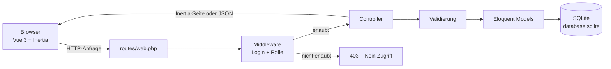
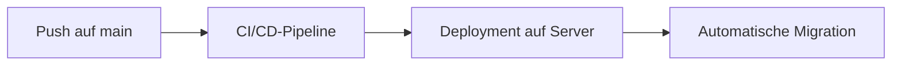
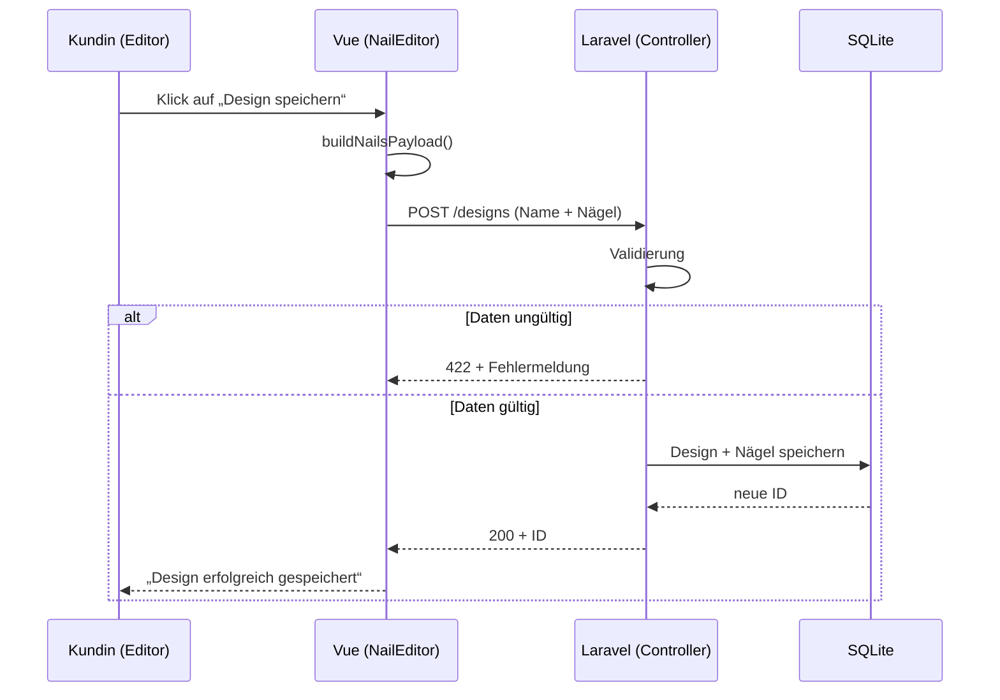

# mixmatch – Backend-Überblick

## Architektur

## Deployment

## Beispiel: Design speichern

## Rollen und Rechte

| Bereich              | Kunde | Mitarbeiter | Admin            | Inhaberin           |
|----------------------|:-----:|:-----------:|:----------------:|:-------------------:|
| Meine Designs        | ✔     | ✔           | ✔                | ✔                   |
| Meine Rechnungen     | ✔     | ✔           | ✔                | ✔                   |
| Studio-Dashboard     | –     | ✔           | ✔                | –                   |
| Studioverwaltung     | –     | –           | nur eigenes Studio | alle eigenen Studios |
| Studio-Rechnungen    | –     | –           | ✔                | –                   |
| Preise, Bewertungen, Benutzer | – | –     | –                | ✔                   |

Das Menü blendet Links nur aus – die eigentliche Sperre prüft das Backend (Middleware/Controller).